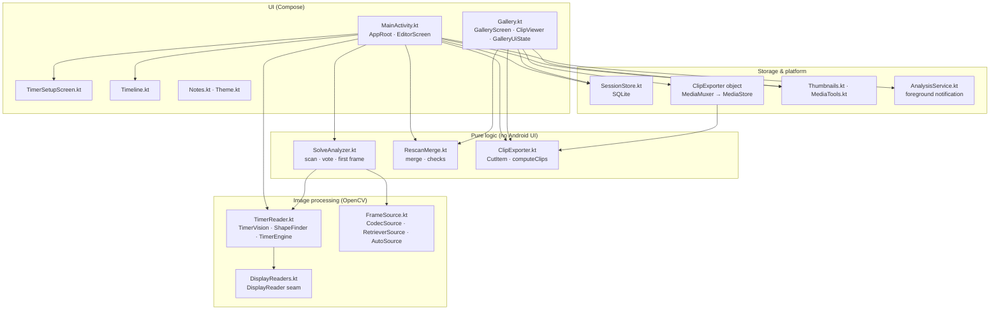
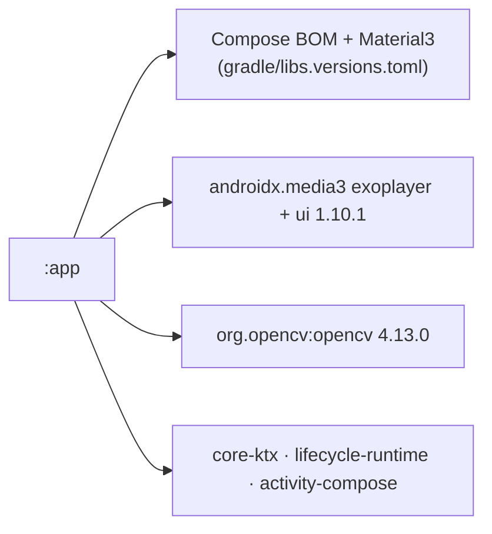
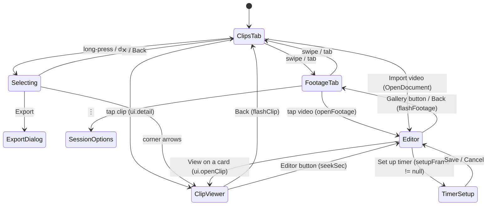
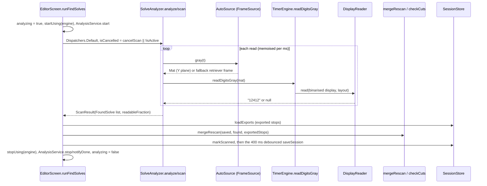
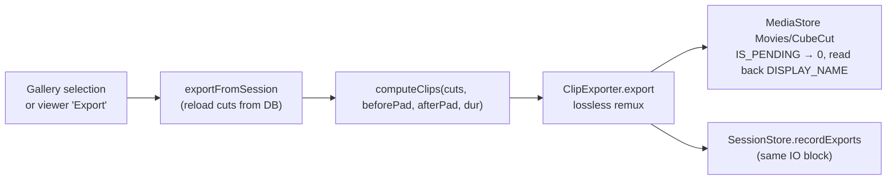

# CubeCut architecture

How the app is put together, the rules that keep it working, where to find things, and recipes for common changes.
Detail lives one level down:
- [app/README.md](app/README.md): file by file.
- [docs/algorithms.md](docs/algorithms.md): scan, digit reading, clip maths.
- [docs/data-model.md](docs/data-model.md): database and identity rules.
- [docs/android.md](docs/android.md): platform, permissions, release.
- [docs/adr/](docs/adr/): why things are the way they are.

## Shape of the app

There is one Gradle module, `:app`, and one flat package, `com.example.cubecut`. The app has no ViewModel, no Navigation Compose, no DI framework and no networking ([ADR-0003](docs/adr/0003-single-module-plain-compose-state.md)). State lives in composables and in a few Kotlin `object` singletons.

The versions are defined in [app/build.gradle.kts](app/build.gradle.kts) and [gradle/libs.versions.toml](gradle/libs.versions.toml).

## Navigation

There is no nav graph. `AppRoot` (`MainActivity.kt`) holds `editor: EditorRequest?`. When it is null the app shows `GalleryScreen`; otherwise it shows `EditorScreen`. Everything else is an `if (state != null)` overlay inside those screens, or an `AlertDialog`. Back is handled by `BackHandler`s.

The Gallery and Editor both open `AboutDialog` from the credit line. The Gallery's ⋮ menu opens Settings, Sort, Filter and Recently deleted. Each dialog is a boolean or nullable "target" flag in the screen that owns it.

## Data flow

### Find solves

### Export (Gallery only)

Clips are never stored. Editor, Gallery and export all call `computeClips` on the saved cuts, so they always agree.

## Invariants (break these and something breaks)

1. **Nothing touches the video, the timer engine or `cuts` while `analyzing` is true.** OpenCV objects, `TimerEngine`, `CodecSource` and `memoReader` are not thread-safe. Any new editor action must be disabled while `analyzing`. In the Gallery the equivalent guard is a running batch export (`batchDone >= 0`).
2. **`TimerEngine` native memory is released by hand.** Every job wraps engine use in `startUsing(engine)` / `stopUsing(engine)`. A replaced engine goes through `retireEngine`. These are plain collections on the main thread, on purpose.
3. **`footageId` is set to null first and set last when the editor switches videos.** This stops the debounced autosave from writing one video's cuts into another video's record.
4. **Any user change to a cut sets `edited = true`** (or `user_edited` in SQL). Otherwise a re-scan overwrites it. The all-clips scramble switch is a video setting, so it does **not** count. See [ADR-0013](docs/adr/0013-rescan-merge-keeps-user-edits.md).
5. **Re-scan matching uses the solve span only, never the scramble.** See `sameSolve` in `RescanMerge.kt`.
6. **Exports link to cuts by `stop_sec` (within `SAME_SOLVE_SEC` = 0.05 s), not by id.** `cuts.id` is regenerated on every `saveSession`, so a moved cut must move its export record. `pendingMoves` and `saveSession` handle this. See [data-model.md](docs/data-model.md#how-exports-link-to-cuts).
7. **"Exported" means the file is not trashed and still opens.** Use the Gallery's rule; never just check that an export row exists.
8. **Nothing is ever deleted for good.** User media goes through `MediaStore.createTrashRequest` after a visual warning. See [ADR-0008](docs/adr/0008-never-delete-permanently.md).
9. **Every schema change bumps `DB_VERSION` and adds a new `if (oldVersion < N)` step in `onUpgrade`.** Never edit an old step. There is no downgrade path.
10. **Colours come only from `MaterialTheme.colorScheme` or `AppColors` (`Theme.kt`).** Fixed colours are allowed only over pictures, in the black viewer and in the deliberately dark timeline panel. Never import `com.example.cubecut.ui.theme`, which is dead template code (see [known-issues](docs/known-issues.md)).
11. **A `DisplayReader` returns `null` when unsure.** The vote relies on unreadable frames rather than wrong guesses.
12. **Keep the `RetrieverSource` fallback.** It is the only protection on untested phones and decoders. See [ADR-0007](docs/adr/0007-mediacodec-frame-source-with-fallback.md).
13. **Check words.** When you change the wording of a scan or check note, update `CHECK_KEYWORDS` (`MainActivity.kt`) so the amber highlight still finds it.
14. **Playhead-driven values are read while drawing, not during composition** (pass `() -> Long`). A coroutine that outlives recompositions calls the newest local functions through `rememberUpdatedState`. Work started with `withContext(IO)` records its own result inside the same block.
15. **Never add the INTERNET permission, and never remove the author credit or the licence headers.** See [ADR-0001](docs/adr/0001-offline-classic-cv-no-ml.md) and [NOTICE.md](NOTICE.md).

## Where to look for X

| I want to change… | Look at |
|---|---|
| How solves are detected, voting, first-frame search | `SolveAnalyzer.scan` / `pickWinner` / `firstAppearance`; constants at the top of `SolveAnalyzer.kt`. Background in [algorithms](docs/algorithms.md#1-finding-solves) |
| How digits are read; supported fonts | `TimerVision` in `TimerReader.kt`; `DisplayReaders.kt` (add a reader here) |
| Timer setup screen and learning | `TimerSetupScreen.kt` (UI); `TimerVision.createSetup` (learning); `SessionStore.saveTimerSetup` / `timerCornersOf` (persistence) |
| Where frames come from, decoder speed | `FrameSource.kt` (`openFrameSource`, `calibrate`) |
| Clip start/end, scramble, buffers | `computeClips` and `parseTimeSeconds` in `ClipExporter.kt` |
| Export file names and where files are written | `ClipExporter.fileName` / `safeTitle` / `openOutput` |
| Re-scan merge, timing checks ("too close", "overlap", "too fast") | `mergeRescan`, `checkCuts` in `RescanMerge.kt` |
| Adding a missed solve | `startManualCut` (`MainActivity.kt`); `solveAtPlayhead` / `solveOverlappedBy` (`RescanMerge.kt`) |
| Importing a video, re-import of a known video | An `OpenDocument` launcher (`picker` in `GalleryScreen`, which also handles relink, or in `EditorScreen`) → `keepAccess` → the editor's "when a video is chosen" effect on `videoUri` → `SessionStore.openOrCreate` (returns `isNew`) |
| Check filter, stepping through checks, *It's fine* | `stepCut`, the *Only show solves to check* filter and `needsCheck` in `EditorScreen`; `checkCuts` (`RescanMerge.kt`); `CutItem.noteNeedsCheck()` |
| Database tables, migrations, video identity | `SessionStore.kt` (`Helper.onCreate` / `onUpgrade`, `openOrCreate`); [data-model](docs/data-model.md) |
| What the Gallery shows, tags, "Solve deleted" | `SessionStore.loadGallery`, `GalleryClip` |
| Gallery sort / filter / persisted UI settings | `ClipKey`, `FootageSort`, `ExportFilter`, `sortClips`, `GalleryUiState` (`Gallery.kt`) |
| Multi-select and batch export | `dragToSelect`, `runBatchExport`, `exportFromSession`, `setScrambleForSelected` (`Gallery.kt`) |
| Full-screen viewer, its player, its flicker | `ClipViewer`, `PlayerOverlay` (`Gallery.kt`); read [algorithms §6](docs/algorithms.md#6-viewer-still-to-video-handover) first |
| Editor layout, solve cards, Edit window, delete/Undo | `EditorScreen` (`MainActivity.kt`): `deleteCut`, `requestDelete`, `pendingMoves`, `stepCut`, `pickSolveAt` |
| Timeline drawing, markers, taps | `Timeline.kt` (`onSeek`, `onPick`, `ClipBar`, `CROWDED_DP` / `ROOMY_DP`) |
| Thumbnails and the Edit window's frame picture | `ThumbCache` (`Thumbnails.kt`): `get`, `peek`, `frame` |
| Notes, info buttons, message colours | `Notes.kt` (`InfoNote`, `InfoButton`, `kindOfMessage`) |
| Colours, dark mode | `Theme.kt` (`CubeCutTheme`, `AppColors`, `ThemeMode`) |
| Background notification during Find solves | `AnalysisService.kt` |
| Trash, restore, Recently deleted | `createTrashRequest` launchers in `Gallery.kt` and `MainActivity.kt`; `SessionStore.setFootageTrashed` / `setExportTrashed` / `loadTrash` / `mediaStoreUriOf` |
| Destructive-action warnings | `DangerButton`, `EffectLine`, `FootageHeader` (`Gallery.kt`) |
| Permissions, SDK, backup, signing | [docs/android.md](docs/android.md) |
| Tuning numbers | [algorithms § Tuning map](docs/algorithms.md#7-tuning-map) |

## Recipes

### New full-screen view or screen
There is no router. Pick the composable that owns the context, either `GalleryScreen` or `EditorScreen`, and add a nullable state (`var x by remember { mutableStateOf<T?>(null) }`). Draw the view as an `if (x != null)` overlay at the end of the screen's root `Box`, and give it a `BackHandler` that clears the state. Copy `ClipViewer` (`ui.detail`) or `TimerSetupScreen` (`setupFrame`).
- A view that must survive leaving the Gallery belongs in `GalleryUiState`, not `remember`.
- Without its own `BackHandler`, Back falls through to the screen underneath. `TimerSetupScreen` currently has this bug, see [known-issues](docs/known-issues.md).
- If the view starts work on the video or engine, gate it on `analyzing` (invariant 1).

### New dialog
Use a boolean or a nullable "target" (`var confirmX by remember { mutableStateOf<Item?>(null) }`) and a Material3 `AlertDialog`. Write the text with `InfoNote`, `BulletLines` and `LeadAndBullets` (`Notes.kt`).
- **Destructive actions:** the picture or header first, then `EffectLine` rows (✓ stays, ✕ goes, ↺ can be restored), and a red `DangerButton` at the bottom. Copy the *Delete video* dialog in `GalleryScreen`.
- **Progress dialogs** that must not be dismissed use `DialogProperties(dismissOnBackPress = false, dismissOnClickOutside = false)`.

### New persisted app setting (not per video)
1. Add a `mutableStateOf` field to `GalleryUiState` (`Gallery.kt`), read from `prefs` in its initializer.
2. Write it in `save()`.
3. Call `ui.save()` at every place the value changes. Nothing saves it automatically.
4. If it shows in Settings, add it to the Settings dialog in `GalleryScreen`.

### New per-video or per-clip field (for example a tag or a penalty)
1. **Schema:** add a column in `Helper.onCreate`, bump `DB_VERSION` and add an `if (oldVersion < N) ALTER TABLE … ADD COLUMN …` step (invariant 9).
2. **Model:** add the field to `Footage` (`SessionStore.kt`) or `CutItem` (`ClipExporter.kt`) with a default value. Read it in `readFootage` / `loadCuts`.
3. **Writes:** `saveSession` deletes and reinserts every cut, so add the column to that insert. A single-field update from the Gallery needs its own `update…` function shaped like `updateCutScramble`, which also sets `user_edited = 1`.
4. **Re-scan:** decide whether `mergeRescan` keeps or replaces the field. A user-set value must mark the cut `edited` (invariant 4).
5. **Gallery:** expose it on `GalleryClip`, then wire sort and filter (`ClipKey`, `ExportFilter`, the Filter dialog, `GalleryUiState` persistence).
6. Update [data-model.md](docs/data-model.md) and the CHANGELOG in the same commit.

### New display reader (another font)
Implement `DisplayReader` (`id`, `available`, `learn`, `read`, optionally `learnUnverified`) in `DisplayReaders.kt` and add it to `DisplayReaders.all`, cheapest first. The winning reader's `id` is stored in `DigitLayout.readerId`. `readerData` is free for the new reader's own data. Return `null` when unsure. Steps 1–3 of the pipeline (find, straighten, binarise) are shared. See [ADR-0014](docs/adr/0014-display-reader-seam.md).

### New tuning constant
Put it next to its siblings as a `private const val` at the top of the file that uses it, with a comment saying what it trades off. Add it to the [tuning map](docs/algorithms.md#7-tuning-map). Only values that several files share go public (like `SAME_SOLVE_SEC`).

### New long-running job
1. Run it in the owning screen's coroutine scope on `Dispatchers.Default` (CPU) or `IO`.
2. Set a busy flag that disables conflicting buttons (invariant 1).
3. Set `view.keepScreenOn`.
4. Let it be cancelled: poll an `isCancelled` and rethrow `CancellationException`.
5. If it must survive leaving the app, start `AnalysisService` (or a sibling service) for its notification.

The work never runs inside the service ([ADR-0011](docs/adr/0011-foreground-service-for-notification-only.md)). It dies if the composable leaves.

### New import or file-picker path
Use `OpenDocument` and `SessionStore.keepAccess` so the URI survives restarts ([ADR-0005](docs/adr/0005-video-identity-heuristics.md)). Do not switch to the photo picker; that decision is settled.
