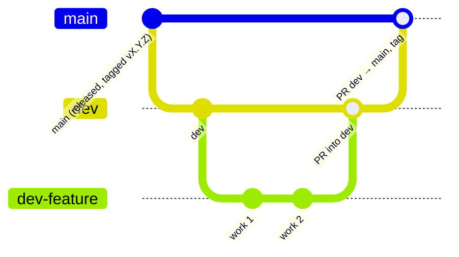

# Contributing

## Branches

- Do the work on a branch made from `dev`. Name it after the work, as the existing branches do: `dev-v3.0.0`, `dev-patch-v3.0.1`, `dev-v3.0.1-doc-enhancements`.
- Open a PR into `dev`, then a PR from `dev` into `main`. Tag the release on `main` ([release steps](docs/android.md#release-process)).
- Never commit APKs, keystores, `local.properties` or test footage. `.gitignore` already covers them.

## Commits: Conventional Commits

Write each commit message as `<type>(<optional scope>): 
`. Allowed types: `feat`, `fix`, `docs`, `refactor`, `perf`, `test`, `build`, `chore`. Example: `feat(gallery): batch delete exported clips`. Breaking changes (for example a DB change that can't be downgraded) add `!` or a `BREAKING CHANGE:` footer.

Older history uses free-form messages and `3.0.1: …` prefixes. New commits follow this convention.

## Every change, before you commit

- [ ] **Update the docs in the same commit as the code.** If behaviour, structure, a rule, the schema, a permission or a tuning value changed, update the doc that owns that fact. [CLAUDE.md](CLAUDE.md#where-facts-live) has the map of which doc owns what. A PR with code but stale docs is not done.
- [ ] Add a line under `## [Unreleased]` in [CHANGELOG.md](CHANGELOG.md), under Added, Changed, Fixed or Removed.
- [ ] If you made a significant design decision, add an ADR in [docs/adr/](docs/adr/).
- [ ] If you changed the schema, bump `DB_VERSION`, add a new `onUpgrade` step and update [docs/data-model.md](docs/data-model.md).
- [ ] `./gradlew assembleDebug testDebugUnitTest` passes.
- [ ] `lintDebug` reports no new errors. It currently fails on two existing errors listed in [known-issues](docs/known-issues.md).
- [ ] Tested on a phone, with exact steps written in the PR: which screen, what to tap, what to expect. Only the Galaxy S25 Ultra has been used so far, so name the device.
- [ ] No scan, digit-reader or `computeClips` behaviour changed unless that was the point of the change.

## Code style

The conventions, with one file to copy for each pattern, are in [CLAUDE.md](CLAUDE.md#conventions).
