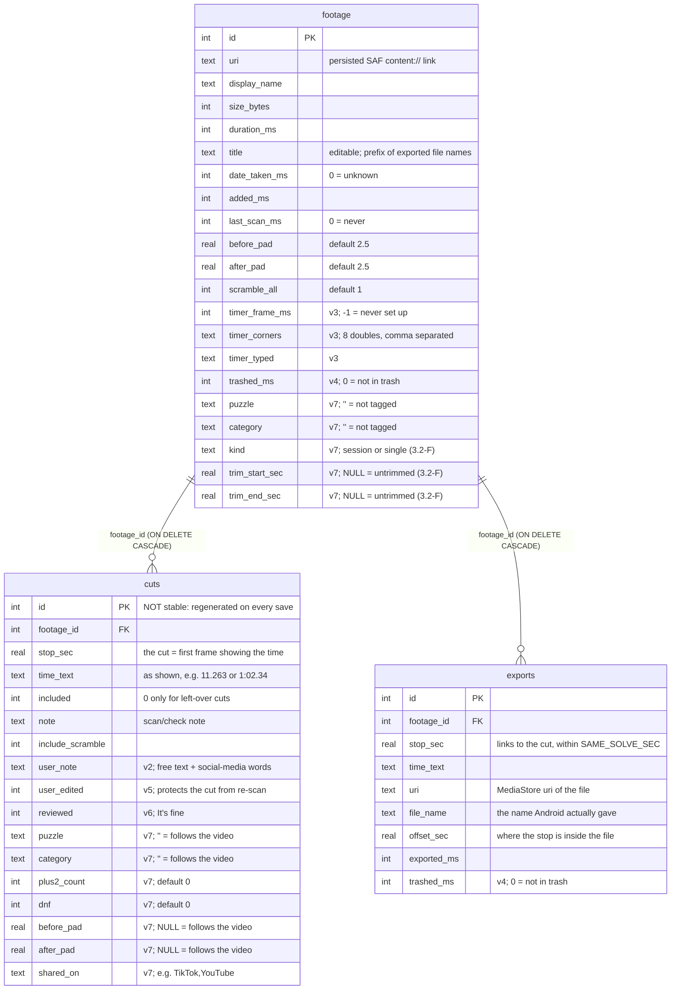

# Data model

Everything CubeCut remembers, how a video is recognised, and how exported files link back to solves. The **source of truth** is the code: `SessionStore.kt` (`Helper.onCreate` and `onUpgrade`) for the schema, and `CutItem` (`ClipExporter.kt`) for the in-memory cut. Why it is raw SQLite: [ADR-0004](adr/0004-raw-sqlite-no-room.md).

## Where state lives

| What | Where | Survives |
|---|---|---|
| Videos, cuts, export records, timer setup per video | SQLite `cubecut_sessions.db` (`SessionStore`) | Restarts. **Not** uninstall, backup or device transfer ([ADR-0009](adr/0009-no-backup-or-transfer.md)) |
| App UI settings: grid/list, columns, sort keys, filters, hidden footage, theme mode, skip seconds, auto-replay, swipe hint | SharedPreferences `cubecut_ui` (`GalleryUiState`) | Restarts |
| Thumbnails and viewer stills | `cacheDir/thumbs` (`ThumbCache`); capped at 100 MB, trimmed to 80 MB | Until Android clears the cache; rebuilt on demand |
| Editor working state: selection, zoom, dialogs, the timer engine | `remember` in `EditorScreen` | Nothing. A process death returns to the Gallery, and cuts survive only through the 400 ms autosave |
| Exported clips | MediaStore `Movies/CubeCut` (user files) | Uninstall, because they are the user's files |
| Persisted URI read grants for imported videos | Android (`takePersistableUriPermission` in `SessionStore.keepAccess`) | Restarts, not reinstall. Capped at 512 grants; *Forget* releases one |
| Legacy 1.x files `timer_setup.json` / `timer_reference.png` | Deleted at start-up by `TimerStore.clear` | — |

## Schema (DB version 7)

Migrations (`onUpgrade`) only add, one `if (oldVersion < N)` block per version:

| Version | Added |
|---|---|
| v2 | `user_note`, `exports` table |
| v3 | timer columns |
| v4 | `trashed_ms` ×2 |
| v5 | `user_edited`, plus a one-off guess at which old cuts were edited |
| v6 | `reviewed` |
| v7 | `footage`: `puzzle`, `category`, `kind`, `trim_start_sec`, `trim_end_sec`. `cuts`: `puzzle`, `category`, `plus2_count`, `dnf`, `before_pad`, `after_pad`, `shared_on`, plus a one-off fill of `shared_on` from the platform names in `user_note` (the note is left as it is) |

### v7 fields (3.2)

Added in 3.2-A with no UI; the later 3.2 phases build the screens. Every default means "nothing changed", so no clip moves on upgrade.

| Field | Meaning | Set by |
|---|---|---|
| `footage.puzzle`, `footage.category` | The video's tags. `''` = not tagged | `updateFootageTags` (a video setting, so no `user_edited`) |
| `cuts.puzzle`, `cuts.category` | The clip's own tags. `''` = follows the video. `GalleryClip.puzzle` / `.category` resolve this | `updateCutTags` |
| `cuts.plus2_count`, `cuts.dnf` | The penalty. `time_text` keeps what the timer showed, so the solve-only start and the export link don't move | `updateCutPenalty` |
| `cuts.before_pad`, `cuts.after_pad` | The clip's own buffers in seconds. NULL = follows the video's slider. `computeClips` uses them for that clip only; its `after_pad` also moves where the next scramble starts | `updateCutPads` |
| `cuts.shared_on` | Where the clip was shared: names from `SOCIAL_PLATFORMS`, comma separated (`encodeSharedOn` / `decodeSharedOn`) | `updateCutSharedOn`. Until 3.2-E, `updateCutNote` also refreshes it from the note, because the platform buttons still write into the note |
| `footage.kind` | `session` (`KIND_SESSION`) or `single` (`KIND_SINGLE`, a clip of one solve, 3.2-F) | 3.2-F |
| `footage.trim_start_sec`, `trim_end_sec` | A single solve's trim in seconds of the file. NULL = untrimmed: the whole file plays | 3.2-F |

All the cut fields go through `saveSession`'s insert and `loadCuts`. `mergeRescan` keeps an edited cut as it is, and when it replaces an untouched cut with the new scan it still carries over every field only the user sets (`withUserFieldsOf`).

There is no `onDowngrade`, so installing an older APK over a newer database crashes on open.

## Video identity

`openOrCreate` decides whether an imported video is one CubeCut has seen before. It tries these in order:
1. same `uri`, and duration within 1000 ms;
2. same `display_name` + `size_bytes` + `duration_ms`;
3. same `size_bytes` + `duration_ms` (skipped if the size is unknown), so a renamed file is still recognised.

On a match it refreshes the stored uri, name and size, and returns `isNew = false`. `findKnown` applies the same rules without changing anything. Both *Import video* buttons call it first, and a known video shows *Imported before* (*Open saved* / *Cancel*) before `openOrCreate` runs, so Cancel leaves no trace. Opening a session from the Gallery doesn't ask. `relink` (*Reconnect video*) attaches a new uri to a saved session and only checks duration within 1500 ms. There is no content hash. Rationale: [ADR-0005](adr/0005-video-identity-heuristics.md).

## How exports link to cuts

- `exports` has **no foreign key to `cuts`**. An export belongs to the cut of the same `footage_id` whose `stop_sec` is within `SAME_SOLVE_SEC` (0.05 s).
- `saveSession` deletes and reinserts every cut in one transaction, so `cuts.id` changes on every save. Never store a cut id anywhere.
- **Moving a cut** in the Edit window is recorded in `pendingMoves`. `saveSession(moves = …)` moves the matching export rows in the same transaction, unless the new spot collides with another cut or another solve's export.
- **Re-export** replaces the earlier record for that solve, except records already in the trash, which stay so they show in *Recently deleted*.
- **"Exported"** in the UI means: a record exists, it is not trashed, and `canOpen` succeeds on its uri.
- An export whose cut was deleted shows in the Gallery as *Solve deleted* (`GalleryClip(index = -1, solveDeleted = true)`).
- An exported file is a copy. Editing the cut afterwards does not change the file or its name.

Single-field writes from the Gallery or viewer (`updateCutScramble`, `markCutReviewed`, `updateCutNote`, and from v7 `updateCutTags`, `updateCutPenalty`, `updateCutPads`, `updateCutSharedOn` through the private `updateCut`) find the cut by `stop_sec` within 0.0005 s, and set `user_edited = 1` where the change is the user's. The exception is `setVideoScramble`: the Gallery's selection scramble switch with every exportable clip of a video ticked sets `footage.scramble_all` and every cut's `include_scramble`, like the editor's all-clips switch, without `user_edited` ([ADR-0013](adr/0013-rescan-merge-keeps-user-edits.md)). The editor and the Gallery never run at the same time (see [ARCHITECTURE](../ARCHITECTURE.md#navigation)), so these writes don't race the editor's delete-and-reinsert save.

## What the Gallery shows (`loadGallery`)

- A video is **present** if `trashed_ms == 0` **and** `canOpen` succeeds. The trash flag wins, because Android still opens trashed files.
- **Video present:** all its cuts show as clips, tagged *Exported* or not, plus *Solve deleted* exports.
- **Video gone or trashed:** only clips with a live exported file show (*Export only*). The cuts stay in the database, so re-importing the video brings everything back.
- Checks (`needsCheck`, `warning`, `noClip`) are computed with `computeClips` and `checkCuts` at load time. They are not stored, except `reviewed`.

## Trash

`MediaStore.createTrashRequest` needs a MediaStore uri. `mediaStoreUriOf` derives one from `media` uris and `media.documents` `video:` ids. A video picked through a folder view has none and cannot be trashed from CubeCut. On `RESULT_OK` the app stores `trashed_ms`; restoring sets it back to 0. Android empties its trash after about 30 days. Rationale: [ADR-0008](adr/0008-never-delete-permanently.md).

## Constraints for planned features

- **Backup and transfer** ([roadmap](roadmap.md) phase 3.2-G; decided: a backup file the user saves, restored with bulk reconnect, superseding ADR-0009): stored `uri`s are SAF grants that don't survive a reinstall. A restore must re-identify videos by name+size+duration (step 2 above), or reconnect them in bulk. `allowBackup="false"` and `data_extraction_rules.xml` currently exclude everything.
- **A new per-cut field** must go through `saveSession`'s insert, `loadCuts` and `withUserFieldsOf` in `RescanMerge.kt`. Follow the recipe in [ARCHITECTURE](../ARCHITECTURE.md#new-per-video-or-per-clip-field-for-example-a-tag-or-a-penalty).
- **A penalty is stored apart from `time_text`** (`plus2_count`, `dnf`), so the solve-only start stays on the raw time. **Changing `time_text`** changes the clip's solve-only start and file name, but not the export link, because the link uses `stop_sec`.
