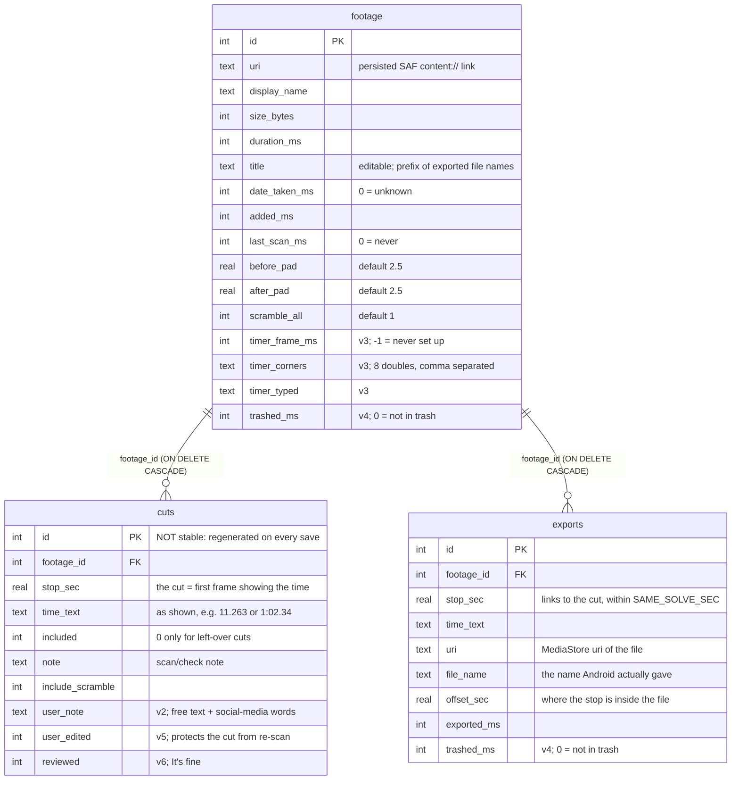

# Data model

Everything CubeCut remembers, how a video is recognised, and how exported files link back to solves. The **source of truth** is the code: `SessionStore.kt` (`Helper.onCreate` and `onUpgrade`) for the schema, and `CutItem` (`ClipExporter.kt`) for the in-memory cut. Why it is raw SQLite: [ADR-0004](adr/0004-raw-sqlite-no-room.md).

## Where state lives

| What | Where | Survives |
|---|---|---|
| Videos, cuts, export records, timer setup per video | SQLite `cubecut_sessions.db` (`SessionStore`) | Restarts. **Not** uninstall, backup or device transfer ([ADR-0009](adr/0009-no-backup-or-transfer.md)) |
| App UI settings: grid/list, columns, sort keys, filters, hidden footage, theme mode, skip seconds, swipe hint | SharedPreferences `cubecut_ui` (`GalleryUiState`) | Restarts |
| Thumbnails and viewer stills | `cacheDir/thumbs` (`ThumbCache`); capped at 100 MB, trimmed to 80 MB | Until Android clears the cache; rebuilt on demand |
| Editor working state: selection, zoom, dialogs, the timer engine | `remember` in `EditorScreen` | Nothing. A process death returns to the Gallery, and cuts survive only through the 400 ms autosave |
| Exported clips | MediaStore `Movies/CubeCut` (user files) | Uninstall, because they are the user's files |
| Persisted URI read grants for imported videos | Android (`takePersistableUriPermission` in `SessionStore.keepAccess`) | Restarts, not reinstall. Capped at 512 grants; *Forget* releases one |
| Legacy 1.x files `timer_setup.json` / `timer_reference.png` | Deleted at start-up by `TimerStore.clear` | — |

## Schema (DB version 6)

Migrations (`onUpgrade`) only add, one `if (oldVersion < N)` block per version:

| Version | Added |
|---|---|
| v2 | `user_note`, `exports` table |
| v3 | timer columns |
| v4 | `trashed_ms` ×2 |
| v5 | `user_edited`, plus a one-off guess at which old cuts were edited |
| v6 | `reviewed` |

There is no `onDowngrade`, so installing an older APK over a newer database crashes on open.

## Video identity

`openOrCreate` decides whether an imported video is one CubeCut has seen before. It tries these in order:
1. same `uri`, and duration within 1000 ms;
2. same `display_name` + `size_bytes` + `duration_ms`;
3. same `size_bytes` + `duration_ms` (skipped if the size is unknown), so a renamed file is still recognised.

On a match it refreshes the stored uri, name and size, and returns `isNew = false`. The editor then silently reopens the saved session; nothing warns the user (see [roadmap](roadmap.md) item 10). `relink` (*Reconnect video*) attaches a new uri to a saved session and only checks duration within 1500 ms. There is no content hash. Rationale: [ADR-0005](adr/0005-video-identity-heuristics.md).

## How exports link to cuts

- `exports` has **no foreign key to `cuts`**. An export belongs to the cut of the same `footage_id` whose `stop_sec` is within `SAME_SOLVE_SEC` (0.05 s).
- `saveSession` deletes and reinserts every cut in one transaction, so `cuts.id` changes on every save. Never store a cut id anywhere.
- **Moving a cut** in the Edit window is recorded in `pendingMoves`. `saveSession(moves = …)` moves the matching export rows in the same transaction, unless the new spot collides with another cut or another solve's export.
- **Re-export** replaces the earlier record for that solve, except records already in the trash, which stay so they show in *Recently deleted*.
- **"Exported"** in the UI means: a record exists, it is not trashed, and `canOpen` succeeds on its uri.
- An export whose cut was deleted shows in the Gallery as *Solve deleted* (`GalleryClip(index = -1, solveDeleted = true)`).
- An exported file is a copy. Editing the cut afterwards does not change the file or its name.

Single-field writes from the Gallery or viewer (`updateCutScramble`, `markCutReviewed`, `updateCutNote`) find the cut by `stop_sec` within 0.0005 s, and set `user_edited = 1` where the change is the user's. The editor and the Gallery never run at the same time (see [ARCHITECTURE](../ARCHITECTURE.md#navigation)), so these writes don't race the editor's delete-and-reinsert save.

## What the Gallery shows (`loadGallery`)

- A video is **present** if `trashed_ms == 0` **and** `canOpen` succeeds. The trash flag wins, because Android still opens trashed files.
- **Video present:** all its cuts show as clips, tagged *Exported* or not, plus *Solve deleted* exports.
- **Video gone or trashed:** only clips with a live exported file show (*Export only*). The cuts stay in the database, so re-importing the video brings everything back.
- Checks (`needsCheck`, `warning`, `noClip`) are computed with `computeClips` and `checkCuts` at load time. They are not stored, except `reviewed`.

## Trash

`MediaStore.createTrashRequest` needs a MediaStore uri. `mediaStoreUriOf` derives one from `media` uris and `media.documents` `video:` ids. A video picked through a folder view has none and cannot be trashed from CubeCut. On `RESULT_OK` the app stores `trashed_ms`; restoring sets it back to 0. Android empties its trash after about 30 days. Rationale: [ADR-0008](adr/0008-never-delete-permanently.md).

## Constraints for planned features

- **Backup and transfer** ([roadmap](roadmap.md) item 5): stored `uri`s are SAF grants that don't survive a reinstall. A restore must re-identify videos by name+size+duration (step 2 above), or reconnect them in bulk. `allowBackup="false"` and `data_extraction_rules.xml` currently exclude everything.
- **A new per-cut field** must go through `saveSession`'s insert and through `mergeRescan`. Follow the recipe in [ARCHITECTURE](../ARCHITECTURE.md#new-per-video-or-per-clip-field-for-example-a-tag-or-a-penalty).
- **Changing `time_text`** (for example a +2 penalty) changes the clip's solve-only start and file name, but not the export link, because the link uses `stop_sec`.
